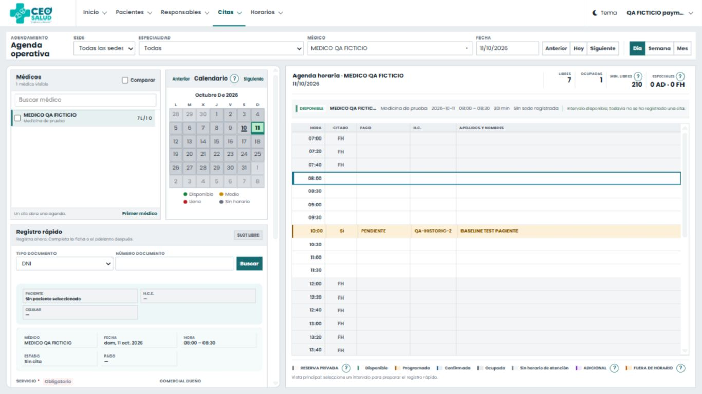
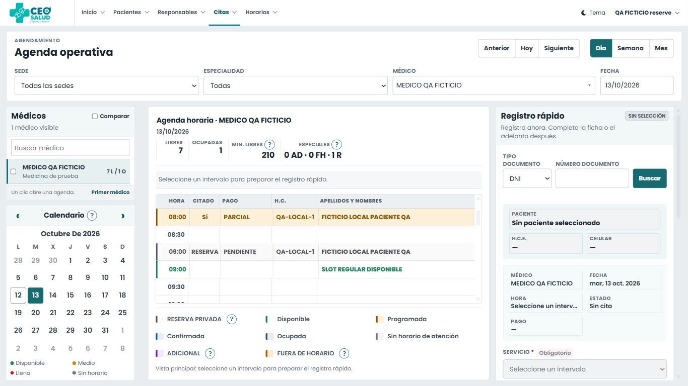

# Entrega 1.1 — Estabilización visual de Agenda

Revisión final: 12 de octubre de 2026. Base remota comprobada: `40dc6a9a43b4f380129fb22c7da4e75bf9bac101`.
Rama: `codex/agenda-estabilizacion-visual-1-1`. Commit de implementación: `85080204af33fc05a22d5189d52205b1dce16992`.

Se conservó el trabajo de la sesión anterior y el entorno de QA existente. El checkout original sigue en `pilot/agenda-horarios-clientes`, con sus cinco modificaciones preexistentes separadas de esta entrega. La distribución aprobada continúa con médicos/calendario a la izquierda, agenda en el centro y registro a la derecha. En 1024 px los selectores quedan arriba y el registro sigue a la derecha; en móvil los componentes siguen el flujo vertical.

## Diagnóstico y alcance

- **Asset productivo, lectura del 10/10:** [agenda.js público](https://srv-prd01.ceosalud.com/js/scheduling/agenda.js?v=20261010) respondió HTTP 200, `Cache-Control: public, max-age=604800`, `Server: hcdn`, `x-hcdn-cache-status: MISS`. Contenía «Confirmar cita» y coincidía con el JS de la base al normalizar finales de línea. La plantilla de la base utilizaba URLs sin versión de contenido. Una versión fija por fecha no invalida todos los despliegues de ese día.
- **Límite del diagnóstico productivo:** no se inspeccionó el DOM, la consola ni la red de la sesión autenticada afectada. No se puede atribuir su etiqueta antigua exclusivamente al CDN. HTML/vistas compiladas antiguas, un recurso antiguo o un fallo durante el arranque seguían siendo posibilidades. La respuesta `MISS` observada no prueba qué recibió antes ese navegador. No hubo acceso autenticado ni cambios productivos.
- **Reserva, causa reproducida:** `updateAppointmentAction()` comprobaba permiso, trabajo en curso y hora, pero omitía paciente y servicio al habilitar Guardar reserva. Se reprodujo la acción habilitada con paciente vacío. La nueva comprobación usa selección completa y los requisitos existentes del importe; reserva sin adelanto continúa permitida.
- **Tema, defecto preexistente confirmado localmente:** `custom.min.js` invocaba `selectpicker` sin cargar su dependencia. Al añadirla, el tema transformaba todos los selectores y dejaba una representación desactualizada de opciones que Agenda cambia dinámicamente. Se carga la dependencia vendorizada y se restaura el selector nativo solamente en Agenda, después del tema.
- **FullCalendar, defectos preexistentes:** estilos compartidos imponían posición relativa/overflow visible a sus scrollers, margen superior y padding de cabeceras. Se restauró su geometría con selectores exclusivos de Agenda. Mes heredaba un formato de cabecera con fechas de referencia de enero; ahora presenta solo nombres de días. Las filas se ajustan al espacio disponible, con «+n más» para consultar eventos que no caben.
- **Legibilidad:** leyenda de 8 px y calendario lateral comprimido. La leyenda usa 12–13 px y una grilla estable; los días laterales usan 14–15 px. A 1366×768 el calendario pasó de unos 198×292 a 256×348 px; a 1920×1080 alcanza aproximadamente 306×464 px. Los radios principales son de 4 px.

## Comportamiento entregado

1. Los JS/CSS propios de Agenda y sus dependencias locales se versionan con los primeros 20 caracteres del SHA-256 del archivo desplegado. Cambiar contenido cambia la URL incluso conservando tamaño y fecha. El HTML autenticado devuelve `private, no-store`. Se mantiene el orden de carga y se bloquean acciones con un aviso si falta un módulo necesario.
2. Guardar reserva empieza deshabilitado y explica permiso, intervalo, paciente, servicio o importe pendiente. Registrar adelanto distingue su permiso `appointment.payment.submit`; la configuración financiera sigue siendo validada por el servidor.
3. Confirmar cita conserva el mínimo del 50% real o exoneración autorizada. Para una reserva existente, la acción principal reutiliza la confirmación operativa con importe cero; no vuelve a cobrar. Registrar adelanto sigue enviando `confirm=false`. El trabajo en curso bloquea las acciones y conserva la protección de duplicados.
4. Se conserva el flujo excepcional explícito de adicional/fuera de horario y las reglas de PR #2 y #3. No hay cambios en servicios financieros, modelos, validadores de peticiones, permisos/roles ni migraciones. Tampoco se incorporan OCR, comprobantes múltiples ni rediseño del mapa de clics. El collector solo recibe versionado cuando se incluye desde Agenda.

## Archivos de implementación y pruebas

| Archivo | Justificación |
|---|---|
| `app/Support/Scheduling/AgendaAssets.php` | Versión por contenido; falla explícitamente si falta un archivo. |
| `app/Http/Controllers/Scheduling/AgendaBoardController.php` | Evitar caché del HTML autenticado de Agenda. |
| `resources/views/scheduling/agenda/index.blade.php` | Tres columnas aprobadas, versiones y dependencias en orden. |
| `resources/views/scheduling/agenda/partials/mini-calendar.blade.php` | Navegación compacta con nombres accesibles intactos. |
| `resources/views/scheduling/agenda/partials/quick-registration.blade.php` | Estado inicial seguro, requisitos y permiso financiero visibles. |
| `resources/views/telemetry/collector.blade.php` | Versión del collector únicamente cuando lo solicita Agenda. |
| `public/css/scheduling/agenda-layout.css` | Anchos, tipografía, radios y responsive; restauración de FullCalendar, todo acotado a Agenda. |
| `public/js/scheduling/agenda-shell.js` | Restaurar los selectores nativos dinámicos tras el tema. |
| `public/js/scheduling/agenda-operational-form.js` | Comprobar preparación de una reserva separada de confirmación. |
| `public/js/scheduling/agenda-operational-workspace.js` | Exponer confirmación de reserva mediante el flujo ya existente y sus controles. |
| `public/js/scheduling/agenda.js` | Arranque seguro, estados de acciones, confirmación existente y sizing/cabeceras del calendario. |
| `tests/Feature/Scheduling/AgendaAssetsTest.php` | Cambios de contenido con igual tamaño/mtime; archivo ausente. |
| `tests/Feature/Scheduling/AgendaBoardTest.php` | HTML fresco, versiones/orden y acciones inicialmente deshabilitadas. |
| `tests/JavaScript/agenda-assets.test.js` | Dependencia ausente y selectores limitados a Agenda. |
| `tests/JavaScript/agenda-operational-form.test.js` | Requisitos de reserva, importe cero y diferencia con el 50%. |
| `tests/JavaScript/agenda-permission-flow.test.js` | Confirmación sin otro pago, bloqueo sin requisitos y doble clic. |
| `tests/Support/agenda-qa-browser-router.php` | Ruta del contenedor visual exclusiva del servidor CLI local. |
| `tests/Support/agenda-qa-viewport.php` | Viewports exactos permitidos en loopback; no es una ruta Laravel productiva. |

Además se entrega este informe y evidencia ficticia en `docs/evidence/agenda-1.1/`.

## Resultados con evidencia

| Verificación | Resultado |
|---|---|
| PHP, PHPUnit 9.6.34 / PHP 8.0.30 / SQLite en memoria | **595 aprobadas, 1 omitida**, 596 casos, 3505 aserciones. [Salida](evidence/agenda-1.1/php-tests-final.txt). |
| JavaScript, suite completa | **196/196 aprobadas**, cero fallos. [Salida](evidence/agenda-1.1/js-tests-final.txt). |
| Sintaxis PHP/JS y `git diff --check` | Aprobados. Las vistas también se renderizaron en pruebas HTTP y navegador. |
| Navegador, tres perfiles ficticios | Sin CREATE: reserva/confirmación bloqueadas. CREATE sin pago: reserva sin adelanto, dinero bloqueado. Ambos permisos + caja ficticia válida: adelanto y confirmación explícita. |
| MariaDB 10.4.32, flujo real de navegador | Reserva sin pago; un adelanto de S/50 mantiene pendiente; confirmación posterior sin otro pago; doble clic crea una sola reserva. [Antes de confirmar](evidence/agenda-1.1/payment-pending.json), [13 controles finales](evidence/agenda-1.1/followup-results.json). |
| Protección de datos de QA ya existentes | Pacientes, citas históricas/previas, pagos, vouchers, horarios, roles y permisos conservados. Usuarios conservados salvo `remember_token`, renovado normalmente al cerrar sesión. Solo se añadió un horario ficticio futuro, dos citas y un pago/voucher ficticio de S/50. No se reinicializó esa base. |

La omisión PHP corresponde a `AppointmentAgendaSchemaTest::test_native_rollback_preserves_all_legacy_columns_rows_indexes_and_foreign_keys`: SQLite instalado es anterior a 3.35 y no soporta el `DROP COLUMN` nativo requerido. **No se marca aprobada.**
La suite automatizada `phpunit.agenda-mariadb.xml` de esta entrega **no se repitió**: sus pruebas concurrentes ejecutan `migrate:fresh` sobre la misma base que contiene el QA y las pruebas manuales conservadas. No se borraron esos datos para ejecutarla. Los controles MariaDB arriba corresponden al flujo de navegador y a verificaciones posteriores en lectura, no sustituyen ni se presentan como esa suite concurrente.

### QA visual

La escala del navegador local era 1,1. El control de viewport de Codex saltaba entre alturas adyacentes en algunos tamaños. Se agregó un contenedor CLI local con un iframe de dimensiones CSS exactas. Se verificó `innerWidth`/`innerHeight` dentro del **documento de Agenda**, con sus media queries y JS reales. No se usó el zoom de previsualización del 45/50% como prueba. Las imágenes pueden tener más píxeles físicos por el DPR; el [registro de dimensiones y geometría](evidence/agenda-1.1/after-metrics.json) conserva los tamaños reales.

| Viewport CSS real | Día | Semana | Mes |
|---|---|---|---|
| 1920×1080 | Aprobado | Aprobado | Aprobado |
| 1366×768 | Aprobado | Aprobado | Aprobado |
| 1024×768 | Aprobado | Aprobado | Aprobado |
| 390×844 | Aprobado | Aprobado | Aprobado |

En las 12 combinaciones: leyenda sin solapamientos, 42 días laterales contenidos, campos sin desborde horizontal y nombres de acciones correctos. En Mes, las seis filas/días están dentro de la superficie del calendario. A 1024 y móvil hay scroll de página; en escritorio los paneles/listas y grillas tienen scroll propio. Se probaron búsqueda/restauración de médico, navegación de fecha, apertura de Día desde Mes, selección semanal exacta 08:30–09:00 y acceso móvil al registro. No se registraron errores/warnings JS nuevos en la sesión de QA de Agenda del 12/10. Los errores iniciales del tema sin `selectpicker` se diagnosticaron y corrigieron localmente para Agenda.

### Capturas antes/después

El «antes» corresponde al main inicial con datos ficticios, guardado antes de los cambios. El «después» conserva la distribución aprobada y usa el horario ficticio del 13/10. No son capturas de producción.

| Tamaño | Antes | Después Día | Semana | Mes |
|---|---|---|---|---|
| 1920×1080 | [Antes](evidence/agenda-1.1/before-1920x1080.jpg) | [Día](evidence/agenda-1.1/after-1920x1080-dia.jpg) | [Semana](evidence/agenda-1.1/after-1920x1080-semana.jpg) | [Mes](evidence/agenda-1.1/after-1920x1080-mes.jpg) |
| 1366×768 | [Antes](evidence/agenda-1.1/before-1366x768.jpg) | [Día](evidence/agenda-1.1/after-1366x768-dia.jpg) | [Semana](evidence/agenda-1.1/after-1366x768-semana.jpg) | [Mes](evidence/agenda-1.1/after-1366x768-mes.jpg) |
| 1024×768 | [Antes](evidence/agenda-1.1/before-1024x768.jpg) | [Día](evidence/agenda-1.1/after-1024x768-dia.jpg) | [Semana](evidence/agenda-1.1/after-1024x768-semana.jpg) | [Mes](evidence/agenda-1.1/after-1024x768-mes.jpg) |
| 390×844 | [Antes](evidence/agenda-1.1/before-390x844.jpg) | [Día](evidence/agenda-1.1/after-390x844-dia.jpg) | [Semana](evidence/agenda-1.1/after-390x844-semana.jpg) | [Mes](evidence/agenda-1.1/after-390x844-mes.jpg) |

[Móvil: calendario lateral](evidence/agenda-1.1/after-390x844-calendar.jpg) · [Móvil: registro y acciones](evidence/agenda-1.1/after-390x844-registration.jpg).

Antes 1366×768:



Después 1366×768:



## Validación local y reversión

Desde el worktree `/.worktrees/agenda-visual`, en PowerShell:

```powershell
& 'C:/xampp/php/php.exe' vendor/phpunit/phpunit/phpunit --colors=never
& 'C:/Program Files/nodejs/node.exe' --test tests/JavaScript/*.test.js
```

Estos tests PHP usan SQLite en memoria y bloquean llamadas externas. Para revisar el entorno **ya existente**, mantener MariaDB en `127.0.0.1:33317` con su datadir propio y el servidor `127.0.0.1:8021`; no ejecutar el seed ni `migrate:fresh` sobre los datos conservados. El router se inicia así si solo el proceso HTTP se ha detenido:

```powershell
& 'C:/xampp/php/php.exe' -S 127.0.0.1:8021 -t public tests/Support/agenda-qa-browser-router.php
```

Acceso ficticio en `/`: `qa-nocreate@example.invalid`, `qa-reserve@example.invalid`, `qa-payment@example.invalid`, contraseña **solo QA** `AgendaQaOnly-2026!`. El helper `IsolatedAgendaQa` impide usar .env, un host/puerto/schema ajeno o un datadir distinto del checkout. El contenedor `/__qa/viewport?width=1366&height=768&fecha=2026-10-13` admite únicamente los cuatro tamaños probados. Repetir con las otras dimensiones, cambiar vistas, buscar médico y seleccionar fechas/intervalos; quitar paciente/servicio y comprobar bloqueo de reserva. Las operaciones de dinero siguen sujetas a permisos y caja del servidor.

Para revertir, crear un commit de reversión del commit de implementación `8508020` en una rama de revisión. La entrega no introduce migraciones ni necesita revertir datos financieros. La documentación/evidencia puede conservarse. No usar `reset`, modificar main ni tocar el checkout original para probar la reversión.

## Riesgos y pasos pendientes

- La causa específica del navegador productivo permanece sin confirmar por la limitación de lectura indicada. El despliegue deberá comprobar HTML nuevo, hashes de assets, cabeceras efectivas del CDN y ausencia de errores de arranque. Limpiar vistas compiladas/autoload/OPcache según el procedimiento autorizado de despliegue; no se ejecutó ese procedimiento en Hostinger.
- La prueba nativa de rollback SQLite y la suite concurrente MariaDB indicada arriba quedan pendientes. No hay cambios de esquema ni de servicios financieros en esta entrega.
- QA visual usó catálogo/usuarios ficticios y un médico; la carga y los tamaños de datos productivos no se inspeccionaron. Los tests PHP/JS cubren también feeds y lógica con múltiples médicos, pacientes, usuarios y horarios; la revisión operativa con volúmenes reales corresponde a una validación posterior autorizada.
- Esta entrega queda para revisión técnica mediante PR Draft. No se fusionó ni desplegó, y no se cambiaron permisos, pacientes, historias, citas o pagos productivos.
