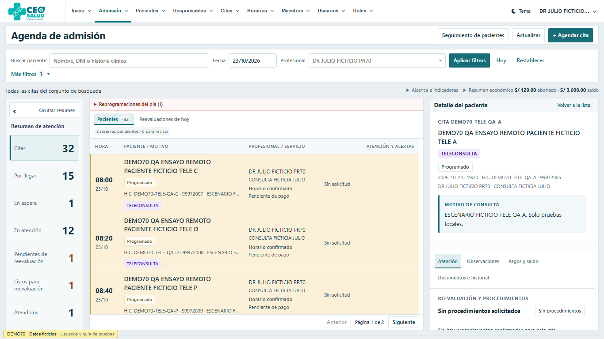
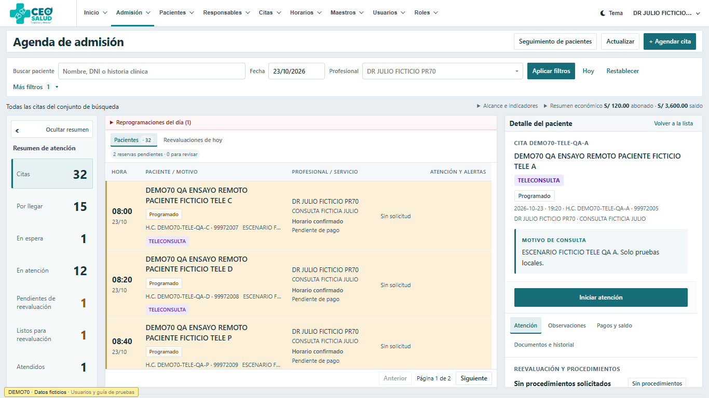
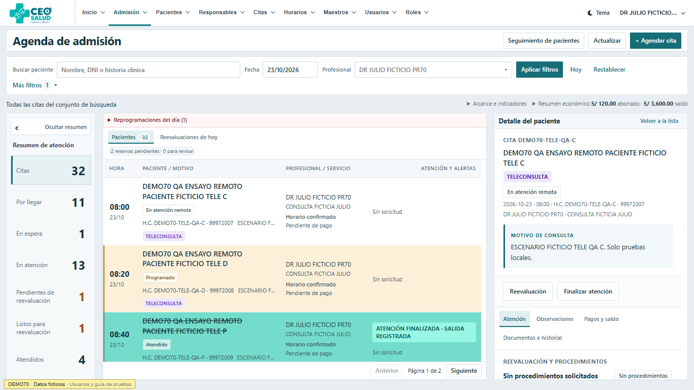
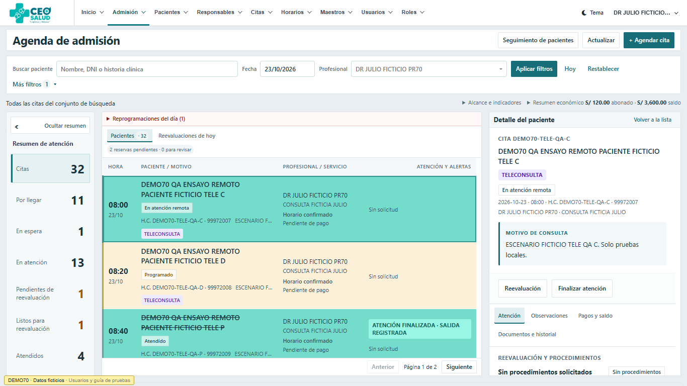

# Hotfix: atención clínica de teleconsultas

## Alcance y base

Rama `codex/hotfix-teleconsulta-clinica-20261024`, basada en `main` **ea1f63401c3b1d20c7005591f4298c4ae744d839**. El trabajo comenzó sobre `02fe2d85`; se incorporaron los dos avances de `main` antes de publicar esta rama. Se conservaron el checkout original y todos los otros worktrees.

Este cambio habilita el episodio clínico existente de Admisión para TELECONSULTA. No crea módulos, endpoints, estados, permisos, migraciones ni contratos API. No modifica Agenda operativa, CSS, precios, pagos ni la configuración/acceso de seguimiento. Los usuarios autorizados de seguimiento siguen siendo **[2, 1, 7]**, sujetos a las verificaciones clínicas actuales.

## Causa y corrección

| Archivo de producto | Bloqueo encontrado / cambio enfocado |
| --- | --- |
| `app/Services/Scheduling/AdmissionBoardService.php` | `careActions()` devolvía `[]` para toda TELECONSULTA. Ahora ofrece inicio desde PROGRAMADO/CONFIRMADO únicamente al médico vinculado de una cita confirmada o heredada válida. Reutiliza las acciones clínicas y los bloqueos de reevaluación existentes; nunca ofrece llegada, llamado o salida remotos. |
| `app/Services/Scheduling/AdmissionCareService.php` | El inicio exigía llegada para todas las modalidades. Ahora la excepción es solo TELECONSULTA; presencial conserva llegada obligatoria. Revalida cuenta, capacidad START/FINISH, doctor y cita bajo los locks existentes y comprueba episodio activo. Registra únicamente hora_atencion/hora_atendido reales y auditoría existente. |
| `app/Support/Scheduling/ClinicalAccess.php` | `activeCare()` restringía la modalidad a presencial. Acepta las dos modalidades explícitas; sigue rechazando finalización/salida previa. Se utiliza en las transiciones clínicas verificadas, manteniendo todos los controles de identidad. |
| `app/Services/Scheduling/AppointmentReevaluationService.php` | La excepción de rechazo del retorno estaba limitada a presencial. Se permite también para la teleconsulta iniciada, con los mismos roles, motivo, confirmación y auditoría; nunca firma una segunda revisión médica. |
| `public/js/scheduling/admission-board.js` | Mostraba que el flujo remoto estaba pendiente y un recorrido físico. Ahora distingue atención/reevaluación remota y muestra únicamente Inicio/Atendido. Por solicitud posterior expresa del usuario, una teleconsulta EN_ATENCION usa el turquesa completo de Admisión `#74dccb`, conservando las prioridades superiores y los datos económicos independientes. No crea badge PRESENTE ni timestamps físicos. |

Otros controles revisados y conservados: llegada y reversión de llegada exclusivamente presenciales; contingencia de médico sin cuenta exclusivamente presencial; mutaciones genéricas/retirada física protegidas; selección y realización de procedimientos separadas; restricciones existentes de fecha, disponibilidad, reservas y vinculación médica. El popup, catálogo personalizado, diagnóstico, observaciones y seguimiento usan sus implementaciones actuales.

## Recorrido y acciones

| Momento | Médico responsable verificado | Admisión / Comercial | Presencia física remota |
| --- | --- | --- | --- |
| Confirmada, PROGRAMADO/CONFIRMADO | Iniciar atención | Acciones operativas actuales; no inicio clínico | Ninguna |
| EN_ATENCION, sin retorno pendiente | Procedimientos, diagnóstico/observaciones, reevaluación o finalizar | Verificar procedimientos según permisos actuales | Ninguna |
| Indicación pendiente | Retirar indicación cuando corresponde; no finalizar anticipadamente | Confirmar indicación | Ninguna |
| Retorno confirmado, procedimientos parciales | No retomar ni finalizar todavía | Verificar avances o autorizar retorno con reglas existentes | Ninguna |
| Listo para reevaluación | Iniciar reevaluación real de la misma cita | Conserva gestión operativa autorizada | Ninguna |
| Segunda atención iniciada | Finalizar atención | Sin suplantar firma médica | Ninguna |
| ATENDIDO | No reiniciar | Sin registrar salida física remota | Ninguna |

Médico distinto, administrador puro, Admisión y Comercial no pueden iniciar/finalizar la atención de Julio. El rol MEDICO sin capacidad clínica tampoco basta. Reserva sin confirmar, cancelación, retiro, no asistencia o cita ya finalizada no habilitan inicio. Las peticiones conservan UUID, hash de payload, expected_state, transacción y locks.

Una reevaluación exige confirmación operativa y segunda atención antes de finalizar. Verificar exámenes o autorizar retorno no los completa ficticiamente. La retirada de indicación y el cierre por rechazo conservan sus eventos diferenciados. Cirugía y RM mantienen seguimiento automático; otros procedimientos conservan envío manual al módulo existente. Ninguna de esas actuaciones crea otra cita o cobro.

## Color solicitado durante la revisión

La presentación compartida excluye correctamente TELECONSULTA de `present`; por eso EN_ATENCION sin pago quedaba blanca. **No se cambió esa verdad clínica ni la paleta compartida**. La adaptación de fondo está limitada al render de Admisión para TELECONSULTA + EN_ATENCION. Mantiene naranja cuando la reevaluación está lista, rojo de desactivación/reembolso y las otras prioridades superiores. Hover y selección siguen usando el mismo fondo completo. Agenda operativa conserva exactamente sus archivos y presentación de `main`.

Se añadieron tres pruebas de comportamiento cromático (incluida no mutación de datos) y se adaptaron dos expectativas estáticas al argumento adicional del render. No se retiró ninguna aserción de hover, selección, fondo completo o borde de PR67.

## Validación

Entorno: PHP **8.3.35**, MariaDB **11.8.9**, SQLite en memoria, Chromium/Chrome real mediante Playwright. Solo loopback, bases QA aisladas y pacientes ficticios DEMO70. Ver [resultado estructurado](evidence/validation.json).

| Verificación | Resultado |
| --- | --- |
| Nuevos casos HTTP SQLite | **8 pruebas / 154 aserciones, sin fallos** |
| Nuevos casos HTTP MariaDB | **8 pruebas / 154 aserciones, sin fallos** |
| Suite completa SQLite | **1.294 pruebas / 11.897 aserciones; 18 fallos y 2 errores heredados** |
| Suite completa MariaDB, incluidos locks reales | **1.330 pruebas / 12.223 aserciones; mismos 18 fallos y 2 errores heredados** |
| JavaScript con el ajuste turquesa | **374 pruebas, sin fallos** |
| Baseline PHP de `main` sin hotfix, subconjunto ClinicalEnterprise | **42 pruebas; exactamente los mismos 18 fallos y 2 errores** |
| Chromium | Atención remota normal, popup oficial/personalizado y diagnóstico, seguimiento automático/manual, finalización; reevaluación con confirmación, 1/2, 2/2, segunda atención y fin; regresión presencial con llegada y salida reales; acceso clínico rechazado a otros cuatro perfiles |
| Responsive | 1366×768 y 390×844: acción disponible, etiqueta TELECONSULTA, recorrido sin pasos físicos, sin overflow horizontal ni errores de consola |
| Integridad | Pagos, vouchers, items, servicios y documentos idénticos antes/después; misma cita en cada recorrido, sin realización ficticia de exámenes ni timestamps físicos remotos |

Las dos regresiones nuevas de concurrencia MariaDB verifican inicio remoto con mismo UUID → 200/200 y un solo evento, y UUID diferentes con estado obsoleto → 200/409, también sin eventos duplicados ni llegada física. Los tests cubren adicionalmente retorno manual con exámenes pendientes, retirada/rechazo, estados inválidos, permisos y bloqueo de endpoints físicos.

### Bloqueo heredado que NO se oculta

`main` usa `medical_followups.authorized_user_ids` tanto en config como en `MedicalFollowupAccess`. Tres fixtures antiguos todavía escriben o exigen la clave singular:

- `tests/Feature/Scheduling/ClinicalEnterpriseTest.php:17`.
- `tests/Feature/Scheduling/ClinicalEnterpriseRoundTwoTest.php:14`.
- `tests/Feature/Scheduling/ClinicalEnterpriseRefinementTest.php:101–103`.

Esto deja al usuario sintético de esos tests fuera de la lista efectiva, causa 403/seguimientos ausentes y errores posteriores (incluido un rollback sobre tabla vacía). El conjunto exacto de casos fallidos se comparó con PHP de `origin/main` sin el hotfix: coincide en ambos motores. No es una regresión introducida por TELECONSULTA. **La suite general no está aprobada.**

Por instrucción expresa del usuario, esos tres archivos y los permisos de seguimiento no se modifican aquí. Propuesta separada: actualizar únicamente sus fixtures/aserciones al contrato plural vigente, comprobando cuentas incluidas y excluidas, sin cambiar la configuración productiva ni reducir controles. Las nuevas pruebas del hotfix ya usan la clave plural en su configuración sintética aislada.

## Evidencia visual

Misma cita QA-A (ID 29) antes y después del inicio habilitado, con pacientes ficticios:

| Antes: sin acciones remotas | Después: iniciar atención |
| --- | --- |
|  |  |

Corrección turquesa, misma cita QA-C (ID 31) EN_ATENCION, sin cambiar datos:

| Antes: blanco | Después: turquesa completo |
| --- | --- |
|  |  |

[Popup reutilizado](evidence/popup-remote.png) · [Segunda atención remota](evidence/remote-second-attention.png) · [Móvil](evidence/final-local-390.png).

## Demo y prueba manual

Demo local ejecutándose: **http://127.0.0.1:8000/demo-guia**. Guía y credenciales ficticias permanecen locales/privadas, fuera de Git. Se conservaron los 23 escenarios anteriores; se añadieron 10 citas sintéticas en huecos libres (33 citas almacenadas, sin duplicar las existentes). Los 5 escenarios MANUAL permanecen inicialmente sin usar; los QA-A/B y QA-P muestran los recorridos ya verificados. QA-C se utilizó durante la revisión manual para comprobar el turquesa.

1. Ingresar como Julio ficticio. Desde la guía abrir **DEMO70-TELE-MANUAL-A**, fecha de demo **23/10/2026**, 14:20: debe verse Iniciar atención, nunca Registrar llegada. Iniciar, solicitar procedimientos y finalizar sin llegada/salida.
2. Usar **DEMO70-TELE-MANUAL-B**, 14:40: iniciar, pedir Laboratorio + RM e indicar reevaluación. Admisión confirma y verifica avances; Julio retoma cuando está listo y finaliza.
3. Usar **DEMO70-TELE-MANUAL-P**, 19:00: es presencial y exige llegada antes de iniciar. La salida sigue separada.
4. Con otro médico o perfiles operativos, comprobar que no existen botones de firma clínica de Julio. Los intentos por endpoint se rechazan.

La fecha local está congelada por el perfil DEMO70 existente; no se cambian fechas productivas. Respaldos, perfiles locales, SQL de QA y automatización Chromium quedan únicamente en `storage/app/qa-tele` / `storage/app/demo-enterprise`, ignorados por Git. No se exportaron datos reales.

## Despliegue y rollback — preparación, no ejecución

**No requiere migraciones** ni seeders, cambios de `.env`, APP_KEY, permisos o tablas. La infraestructura del PR72 debe estar ya instalada según el entorno publicado. No incluir carpetas demo, vendor copiado de QA, respaldos ni configuración local en el artefacto.

Antes de autorizar publicación:

1. Resolver o acordar explícitamente el bloqueo de checks heredados; comprobar HEAD del PR, base y ausencia de conflictos. No declarar CI verde mientras falle.
2. Registrar SHA productivo real y respaldar código, BD y archivos privados con el procedimiento ya autorizado. No revelar APP_KEY ni cambiarla.
3. En una ventana autorizada, publicar únicamente el artefacto revisado; conservar configuración y archivos persistentes. No ejecutar `migrate`, `migrate:fresh`, seeders ni datos DEMO70 por este hotfix.
4. Aplicar el procedimiento existente de cachés/OPcache. `AgendaAssets` incorpora versión de contenido para el JS; comprobar que el navegador recibe el archivo nuevo.
5. Smoke con datos sintéticos autorizados: médico correcto, teleconsulta confirmada, inicio→procedimientos→fin; llegada/salida null; presencial sin llegada bloqueado; reevaluación con retorno real; permisos y pagos intactos. No ensayar sobre pacientes reales.

Rollback: restaurar el artefacto de código previo y cachés mediante el procedimiento autorizado; **no revertir BD ni borrar eventos, procedimientos, seguimientos o auditorías**. Los datos escritos usan estados y tablas existentes. Una teleconsulta que haya quedado abierta en EN_ATENCION puede perder sus botones con el código anterior: registrar ese riesgo operativo y preferir corrección hacia adelante o contención supervisada. Nunca cambiarla a presencial ni inventar llegada/salida para resolverlo.

No se accedió a Hostinger. No hubo merge, despliegue ni cambios productivos. La validación local no acredita la duración/bloqueos reales de una publicación productiva ni sustituye su autorización.
